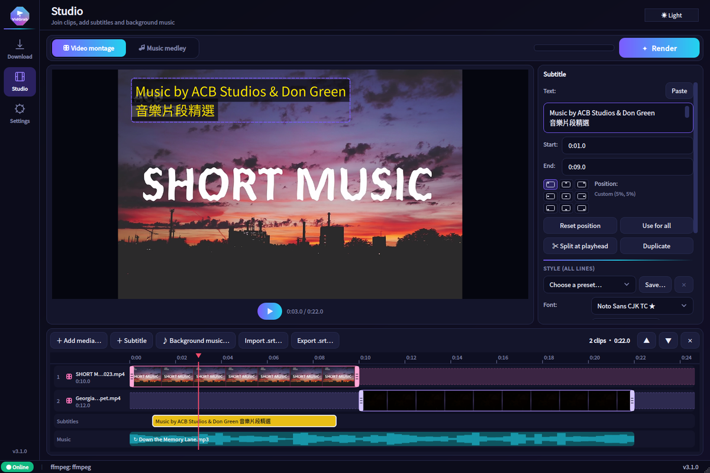
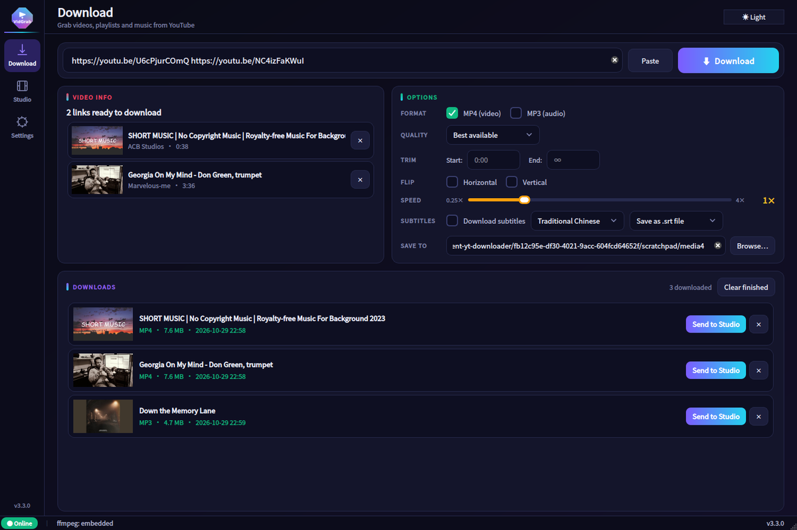
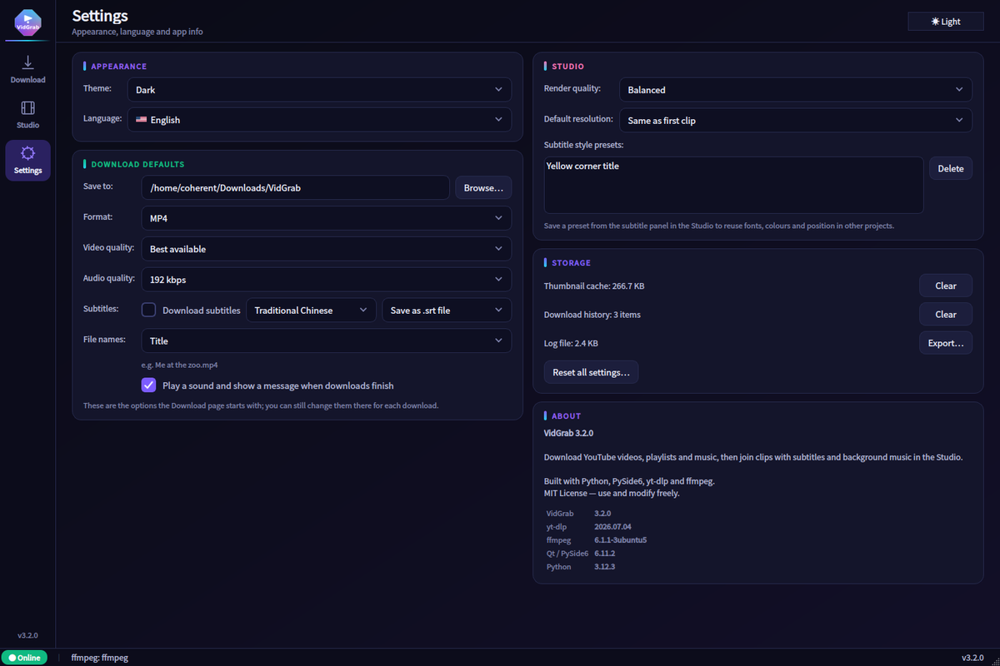
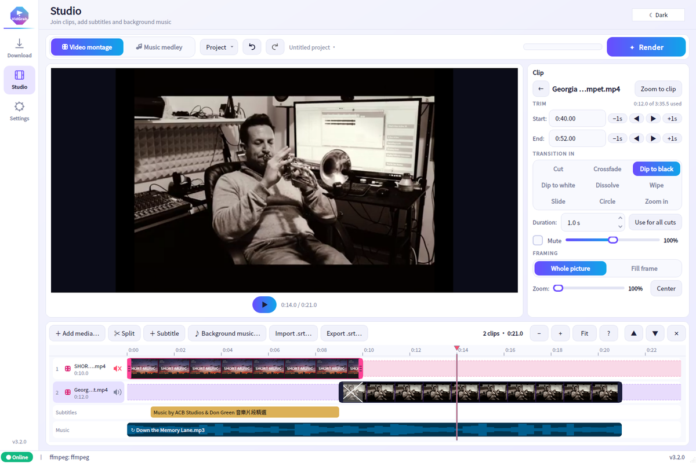

<div align="center">


# VidGrab

**Download from YouTube. Edit in the Studio. One portable app.**

Grab videos, playlists and music from YouTube, then cut them into a montage or medley
with subtitles and background music. No installation, nothing else to set up.

[](https://github.com/coherent17/VidGrab/actions/workflows/ci.yml)
[](https://github.com/coherent17/VidGrab/releases/latest)
[](https://github.com/coherent17/VidGrab/releases)

[](LICENSE)

[**Download**](https://github.com/coherent17/VidGrab/releases/latest) ·
[Demo video](docs/VidGrab-demo.mp4) ·
[User guide (繁體中文)](docs/VidGrab-user-guide-zh-TW.pdf) ·
[Changelog](CHANGELOG.md)



</div>

---

## Highlights

- **Download anything you paste.** Paste one link or a whole list. Each one gets a preview with thumbnail and length, then joins a queue with live progress, speed and ETA.
- **Edit like a video editor.** Every clip has its own timeline row. Drag its two handles to choose where it starts and ends; the preview shows the exact frame.
- **Subtitles that look right.** Place lines by dragging or with a 3×3 grid, pick colours and a background box, add a fade. What you see in the preview is what gets rendered.
- **Portable.** A single executable for Windows or Linux with ffmpeg built in. The UI is in English and 繁體中文, with dark and light themes.

## Download

| Platform | File | How to run |
|----------|------|------------|
| Windows 10 / 11 (x64) | `VidGrab-windows-x64.exe` | Double-click |
| Linux x64 (glibc ≥ 2.35) | `VidGrab-linux-x64` (or `.tar.xz`) | `chmod +x VidGrab-linux-x64 && ./VidGrab-linux-x64` |

Grab them from the [latest release](https://github.com/coherent17/VidGrab/releases/latest), which also includes
the demo video, the user guide and `SHA256SUMS.txt` for verifying downloads.

## Features

### ⬇ Download

- **MP4, MP3 or both** in one pass. Pick the quality from 4K down to 360p (MP3 at 128–320 kbps); at any resolution H.264 is preferred so files play everywhere
- **Several links at once** with a per-link preview (thumbnail, title, length, playlist size); remove any link before you start
- **Download queue** that runs one item at a time, with progress, speed, ETA, **Cancel** and **Retry**
- **Recent downloads** that stay between sessions; **Send to Studio** puts a file (and its subtitles) straight onto the timeline
- **Playlists and channels**: every video, numbered in order
- **YouTube subtitles** in 繁體中文, 简体中文, English or 日本語 (uploaded or auto-generated), saved as `.srt` or burned in. Timings follow any trim or speed change
- **Trim, flip and speed (0.25×–4×)** applied while downloading

### 🎬 Studio

- **Video montage**: join videos of any size or orientation into one MP4 (match the first clip, 1080p / 720p / 480p, vertical 9:16 or square). Clips without sound get silence
- **Music medley**: join songs or parts of songs into MP3 / M4A / WAV, with a crossfade between tracks
- **Multi-track timeline**: one row per clip, with thumbnails or waveforms. Drag the left and right handles to trim, drag a clip up or down to reorder, and click to seek. Zoom with Ctrl+wheel; handles and subtitles snap to the playhead and to each other
- **Editing like an editor**: undo / redo, split a clip at the playhead, keyboard trimming (I / O) and playback (J / K / L, frame steps)
- **Projects**: save the timeline as a `.vgproj` file and pick up where you left off (Open recent)
- **Transitions** between clips (crossfade, dip to black / white, wipe, slide, circle, zoom…) and **framing**: fill a vertical or square frame from a landscape clip, zoom in, and drag to choose what stays in view
- **Subtitles**: add a line at the playhead, then drag it in the preview or snap it with the position grid. Retime it by dragging its block, and split or duplicate lines. Style options: font, bold, text colour, background box with opacity, fade in / out, and reusable **style presets**. Import or export `.srt`
- **Background music**: cut the song with handles and choose when it comes in; separate music and original-audio volume, looping and an end fade. The preview plays it in sync with the video
- **Per-clip sound**: mute any clip from its timeline row, or set its volume (0–200 %)
- **One-pass render** with a live progress bar and Fast / Balanced / High quality presets

### ⚙ Settings

- **Download defaults**: save folder, format, quality, subtitles and a file-name pattern (title, title + ID, channel – title, date + title), plus a sound and message when the queue finishes
- **Studio defaults**: render quality, output resolution and subtitle style presets
- **Storage tools**: clear the thumbnail cache or download history, export the log, reset all settings. The About section shows the yt-dlp, ffmpeg and Qt versions

## Screenshots

| Download page | Settings |
|:---:|:---:|
|  |  |
| **Studio, light theme** | |
|  | |

## Using VidGrab

1. **Download**: copy one or more YouTube links and click **Paste**. Check the previews, choose the format and quality, then click **Download**.
2. **Send to Studio**: in the download list, click **Send to Studio** on a finished video (or use **＋ Add media** in the Studio).
3. **Edit**: drag each clip's handles to trim it. Add **♪ Background music** and **＋ Subtitle** lines, then style and position them.
4. **Render**: choose the resolution and file name, then click **Render**.

The **[user guide](docs/VidGrab-user-guide-zh-TW.pdf)** (繁體中文) walks through every page with screenshots, and the
**[demo video](docs/VidGrab-demo.mp4)** shows the whole flow with narration.

Keyboard shortcuts: `Ctrl+V` pastes a link and `F1` shows About. In the Studio:

| Keys | Action |
|------|--------|
| `Space` / `K` | Play / pause |
| `J` / `L` · `←` / `→` | Back / forward 1 second · one frame |
| `I` / `O` | Trim the clip under the playhead to start / end there |
| `S` | Split the clip under the playhead |
| `M` | Mute / unmute the selected clip |
| `Delete` | Delete the selected clip or subtitle |
| `Ctrl+Z` / `Ctrl+Y` | Undo / redo |
| `Ctrl+wheel` · `Ctrl+0` | Zoom the timeline · fit the whole project |
| `Z` | Zoom to the selected clip |
| `Ctrl+S` / `Ctrl+O` / `Ctrl+N` | Save / open / new project |

Hold `Alt` while dragging to turn snapping off, or `Shift` for fine (1/10-speed) trimming; drag a handle past the edge of the timeline to keep extending the clip. The **?** button in the timeline lists every shortcut.

### Typing Chinese on Linux / WSL

The Windows build uses the Windows input method directly. Under WSL, Linux apps can't receive input from the Windows input
method, so either paste the text (Ctrl+V or the **Paste** button) or install ibus. VidGrab uses ibus automatically when
it's installed:

```bash
sudo apt install ibus ibus-chewing   # or ibus-libpinyin for pinyin
ibus-daemon -drx                     # add to ~/.profile to start it automatically
```

## Building from source

Requires Python 3.10+.

```bash
make setup    # create .venv and install dependencies (one-time)
make ffmpeg   # download the pinned ffmpeg 9.0.2 into ffmpeg/linux (one-time)
make run      # launch the app
make lint     # ruff
make test     # pytest, including a headless GUI smoke test
make build    # standalone binary for the current OS -> dist/
```

On Windows, use `python -m venv .venv`, `.venv\Scripts\activate`, `pip install -r requirements.txt` and
`python -m vidgrab`, or build with `scripts\build.ps1` (which fetches the pinned ffmpeg itself).

Every build, CI job and development setup uses the one ffmpeg version pinned in `ffmpeg/pin.json`
(SHA-256 checked); see `ffmpeg/README.txt` to upgrade it.

> Missing Qt libraries on Linux? `sudo apt install -y libegl1 libgl1 libxkbcommon0 libfontconfig1 libxcb-cursor0 libxcb-xinerama0 libdbus-1-3`

<details>
<summary><b>Project layout</b></summary>

```
vidgrab/
  app.py              main window, Download and Settings pages, download queue
  studio_page.py      Studio workspace and multi-track timeline
  preview.py          in-window preview player with draggable subtitles
  studio.py           ffmpeg engine: joining, subtitles (ASS), music, thumbnails and waveforms
  downloader.py       yt-dlp downloads, subtitles, trim / flip / speed
  jobs.py             one queued download (media + subtitles)
  downloads_panel.py  download list rows and history
  i18n.py             English / 繁體中文 strings
assets/               icon, flags, bundled Noto Sans CJK TC font
docs/                 demo video, user guide, screenshots
tests/                pytest suite (unit, GUI smoke, real-ffmpeg renders)
VidGrab.spec          PyInstaller spec (bundles ffmpeg + Qt)
```

</details>

<details>
<summary><b>CI and releases</b></summary>

Every push and pull request is linted and tested on Linux and Windows, and both standalone binaries are built. Each
build also renders real Studio projects with the exact ffmpeg it bundles.

To release, bump `vidgrab/_version.py`, add a `## <version>` section to `CHANGELOG.md`, and push a matching tag
(`git tag vX.Y.Z && git push origin vX.Y.Z`). The release workflow checks the tag against the version, builds both
platforms and publishes the executables, the demo video, the user guide and `SHA256SUMS.txt`, with notes taken from
the changelog.

</details>

## Troubleshooting

| Problem | Fix |
|---------|-----|
| "Video unavailable" / HTTP 403 | YouTube changes often; update to the latest VidGrab release |
| Video downloaded at only 360p | YouTube refused the high-quality stream, so VidGrab fell back to a reliable low-resolution one. Try again later |
| Antivirus warning | Common with PyInstaller apps; add an exception |
| Can't type Chinese | See [Typing Chinese on Linux / WSL](#typing-chinese-on-linux--wsl), or paste the text |
| Studio preview shows no picture | The packaged app includes QtMultimedia; from source, make sure PySide6 includes it |

## License

[MIT](LICENSE). Built with [yt-dlp](https://github.com/yt-dlp/yt-dlp), [FFmpeg](https://ffmpeg.org),
[PySide6 (Qt)](https://doc.qt.io/qtforpython/) and [Noto Sans CJK](https://github.com/notofonts/noto-cjk).

Only download content you have the right to use.
